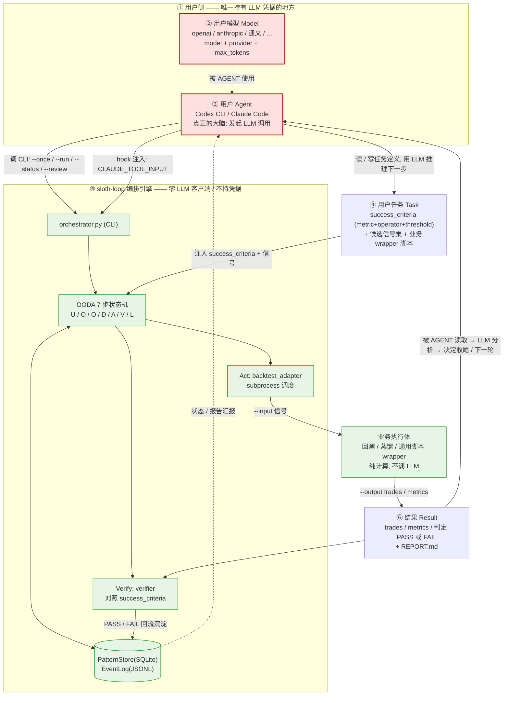

# loop 与 Agent 的挂载关系 · LLM 额度归属与职责边界

> 状态: 已验证（真实代码证据，非推断） | 日期: 2026-10-20
> 锚定: sloth-loop-0927 @ `0e7a9f0`（master）/ sloth-loop @ `699af45`（dev）；两仓同源，结论通用。
> 触发: 疑问「sloth-loop-0927 没有配置接入 LLM 的入口，只能让 codex / claude 做任务挂载。
>       执行任务时消耗的 LLM 是用户的额度吗？agent / 模型 / 任务 / loop / 结果 是什么关系？」

## 0. 结论速览

1. **sloth-loop 本身是「零 LLM」的纯编排状态机** —— 不含任何 LLM 客户端、不持有任何 API 凭据、不发生任何 LLM 网络调用。
2. **loop 执行任务时消耗的是「挂载它的那个 agent（Codex / Claude Code）」的额度** —— 谁挂载，就是谁的账号 / 模型 / 额度。
3. 五要素是一条 **大脑（Agent）/ 身体（loop）** 的分工链：Agent = 大脑（烧额度），loop = 身体（不烧额度），Task = 目标，Model = 大脑配置，Result = 身体产出。

> **一句话**：sloth-loop = 一个**没有大脑的身体**。它把「思考」通过 CLI + Hook + Prompt 资产三个接口
> **外包给挂载它的 Codex / Claude**；自己只负责「下一步做什么（状态机）／怎么跑（子进程）／
> 算不算成功（Verifier）／记住什么（PatternStore）」。

## 1. Q1 · 额度归属：证据链

判据：**loop 是否持有任何 LLM 凭据 / 是否发起任何 LLM 调用**。逐条核实（全部真实代码）：

| # | 证据 | 位置 | 说明 |
|---|---|---|---|
| 1 | 依赖中**没有任何 LLM SDK** | `pyproject.toml` → dependencies | 只有 `fastapi / uvicorn / pyyaml / pydantic / httpx2`；无 openai / anthropic / dashscope / langchain / litellm |
| 2 | openai / anthropic 被**注释掉、标注为「可选扩展」** | `sloth_engine/requirements.txt` | `#   openai / anthropic   # 信号生成接入 LLM` |
| 3 | 全仓（排除 `.venv`）**零命中** | 搜索 `(import\|from) (openai\|anthropic\|dashscope\|langchain\|litellm\|zhipuai\|ollama)` | 源码里根本没有 LLM 客户端 |
| 4 | 「推理」这一步被**显式外包** | `sloth_engine/ooda_pipeline.py:160` | `Agent-level reasoning is supplemented by the external OODA skill in Claude Code.` |
| 5 | LLM 复核是**未实现的占位** | `sloth_engine/guardian/risk_assessor.py:340` `def llm_review(...)` | `raise NotImplementedError("LLM review is not yet implemented.")` |
| 6 | 唯一的「OpenAI 风格」代码只是**序列化器** | `sloth_engine/context_fragment.py:631` `to_messages()` | 注释为 `Convert to OpenAI-style message list`；只产出 list，无人发送 |
| 7 | 子代理的 `model / provider` 只是**元数据** | `sloth_engine/sub_agent.py` | `run_subagent(context, executor_fn)` —— executor 由**调用方注入**，自身不调模型 |
| 8 | 它其实是被 Claude Code **反向调用**的 | `sloth_engine/hooks_check.py:39 / 50 / 61` | 读 `os.environ["CLAUDE_TOOL_INPUT"]` → Claude Code 的 hook，方向是 Claude → loop |
| 9 | 全仓**没有任何**拉起 `codex` / `claude` 命令的代码 | `sloth_engine/`、`scripts/` | 0 命中；loop 不自己起 agent |
| 10 | 官方定位：**CLI 工具，不是服务** | `README.md` | 「核心入口：`python sloth_engine/orchestrator.py`（CLI 工具，非 MCP Server）」 |
| 11 | `telemetry.py:137-143` 的 `LLM_*` 只是 **OpenInference 属性名常量** | `sloth_engine/telemetry.py` | 观测定名，非调用 |
| 12 | `webui.py` 的 `Bearer` 是 **Dashboard 写端点鉴权** | `sloth_engine/webui.py:69-74` | 保护 WebUI API，与 LLM 无关 |

**这 12 条合起来只有一种解释**：loop 是一个「哑」引擎 —— 它决定**下一步该做什么**（OODA 状态机）、
把**上下文拼成字符串**（`agent-prompts/*.md` + `prompt_renderer.py`）、**调度子进程**跑任务
（`backtest_adapter`）、**判定结果**（`verifier`）、**沉淀经验**（`pattern_store`）。真正的「思考」由外部 agent 完成。

**直接推论**：

- 同机多个 loop 并发 → 各自烧各自挂载 agent 的额度。
- 多 agent 压测 → 烧的是那些 agent 的额度，与 loop 无关。
- 结论：**额度 100% 属于挂载方（用户 agent）的账号**。

### 1.1 如果想变成「loop 自己烧额度」

需按 `sloth_engine/requirements.txt` 注释启用 `openai / anthropic`，并实现
`guardian/risk_assessor.py::llm_review()`（当前 `NotImplementedError`）。
**当前没有该入口** —— 这正是「只能让 codex / claude 做任务挂载」的根本原因。

## 2. Q2 · 五要素关系

### 2.1 静态关系图（谁持有、谁驱动、谁烧额度）



> 红色（MODEL / AGENT）= 烧额度；绿色 = 不烧额度。整条 loop 链路全是绿色。

### 2.2 一轮 OODA 时序图（额度在哪个箭头产生）

```mermaid
sequenceDiagram
    autonumber
    actor User as 用户
    participant AG as 用户Agent(Codex/Claude)
    participant LLM as LLM服务(用户额度)
    participant LOOP as sloth-loop引擎
    participant WRAP as 业务wrapper(子进程)
    participant ST as PatternStore/EventLog

    User->>AG: 给目标 + 候选信号 + success_criteria
    AG->>LLM: 推理该做什么 (Understand/Orient/Decide)
    LLM-->>AG: 计划与下一步指令
    Note over LLM,AG: 这里消耗用户额度 (唯一烧钱点)
    AG->>LOOP: python orchestrator.py --once / --run
    LOOP->>ST: 读失败模式库 + 排除规则
    ST-->>LOOP: 排除清单
    LOOP->>WRAP: subprocess --input 信号(json)
    WRAP-->>LOOP: --output trades/metrics (json)
    LOOP->>LOOP: Verify 对照 success_criteria
    LOOP->>ST: 写失败/成功模式 + 生成 REPORT.md
    LOOP-->>AG: 状态 / 结果 / 报告路径
    AG->>LLM: 分析结果, 决定收尾或下一轮
    LLM-->>AG: 下一轮策略
    Note over LLM,AG: 再次消耗用户额度
    AG-->>User: 汇报: 成功判定结果 / 报告
```

### 2.3 职责对照表

| 要素 | 是什么 | 谁提供 | 是否烧额度 | 关键代码 |
|---|---|---|---|---|
| **用户模型 Model** | 模型名 / 供应商 / 参数 | 用户（在 agent 侧配置） | — | `sub_agent.AgentContext`（仅元数据占位） |
| **用户 Agent** | Codex / Claude Code | 用户 | **是（全部额度在这）** | 外部进程，不在 loop 仓内 |
| **用户任务 Task** | 目标 + 成功标准 + 信号 | 用户 | 否 | `projects/<domain>/<task>/`、`task_runner.TaskInput` |
| **loop** | OODA 编排 + 状态机 + 持久化 | 产品（本仓） | 否（零调用） | `orchestrator.py`、`ooda_pipeline.py` |
| **结果 Result** | trades / metrics / 判定 / 报告 | loop 产出 | 否 | `task_runner.TaskResult`、`report_util.py` |

## 3. loop 与 Agent 的 4 个接触面

| 接触面 | 方向 | 载体 | 证据 |
|---|---|---|---|
| **CLI 调用** | Agent → loop | `orchestrator.py --once / --run / --status / --review` | `cli_router.py` |
| **Hook 回注** | Claude Code → loop | `CLAUDE_TOOL_INPUT` 环境变量 | `hooks_check.py:39 / 50 / 61` |
| **Prompt 资产** | loop → Agent（产出字符串） | `agent-prompts/{pre,post}-backtest.md`、`meta-loop.md`、`prompt_renderer.py` | `prompt_renderer.py:52`（仓内**无调用方**，纯给外部 agent 读） |
| **结果 / 状态** | loop → Agent（回读） | `runtime.root` 下 EventLog / PatternStore / `reports/<date>/REPORT.md` | `report_util.py`、`event_log.py` |

## 4. 术语澄清（避免误读）

| 看起来像 LLM 的东西 | 实际含义 |
|---|---|
| `telemetry.py` 的 `llm.system / llm.model_name / llm.token_count.*` | **OpenInference 语义约定属性名常量**（观测字段命名），不代表调用 |
| `context_fragment.to_messages()` | 把 fragment 序列化成 OpenAI 风格 dict 列表；**没有发送方** |
| `webui.py` 的 `Bearer` / `LOOP_WEBUI_TOKEN` | WebUI **写端点鉴权**，与模型凭据无关 |
| `sub_agent.AgentContext.model / provider / max_tokens` | **元数据字段**；`run_subagent(ctx, executor_fn)` 的 executor 由调用方注入，自身不调模型 |
| `plugins/memory/dsh-credentials` | **凭据「引用」seam**：只存 env-var 名（`CredentialRef`），不存值；供插件解析，非 LLM 客户端 |
| `mcp_client.py` | **出站 MCP 客户端**（JSON-RPC over stdio），调用外部 MCP 工具，非 LLM |
| `hooks_check.py` 读 `CLAUDE_TOOL_INPUT` | **Claude Code 反向调用 loop** 的 hook 入参，方向是 Claude → loop |
| `guardian/risk_assessor.py::llm_review()` | **未实现的占位**，调用即 `NotImplementedError` |

## 5. 复核命令（可自行重跑，全只读）

```powershell
cd <sloth-loop-0927>

# 1) 无 LLM SDK 依赖（应只有 fastapi/uvicorn/pyyaml/pydantic/httpx2）
Get-Content pyproject.toml

# 2) 全仓无 LLM 客户端导入（排除 .venv；期望 0 命中）
Get-ChildItem -Recurse -Include *.py |
  Where-Object { $_.FullName -notmatch '\\\.venv\\' } |
  Select-String -Pattern '(import|from)\s+(openai|anthropic|dashscope|langchain|litellm|zhipuai|ollama)'

# 3) 推理外包给 Claude Code
Select-String -Path sloth_engine\ooda_pipeline.py -Pattern 'external OODA skill in Claude Code'

# 4) LLM 复核未实现
Select-String -Path sloth_engine\guardian\risk_assessor.py -Pattern 'NotImplementedError'

# 5) Claude Code hook 入口（反向调用证据）
Select-String -Path sloth_engine\hooks_check.py -Pattern 'CLAUDE_TOOL_INPUT'
```

## 6. 易混淆：`--doctor` 不是状态查询

| 命令 | 作用 | 何时用 |
|---|---|---|
| `--doctor` | **环境自检 / 预检（preflight）**：Python 版本、PyYAML、OODA 模式、模式库读写、回测脚本 containment + 存在性 + **契约探针**（跑一次探针信号，要求 ≥1 trade）、数据目录可写、loop 限制、契约(BUDGET/STOP/SCOPE)。退出码 0 = Ready，1 = Blockers（见 `orchestrator.py:481 def doctor()`） | **开跑前**，类似 `git fsck` / `brew doctor` |
| `--status` | 模式库状态（失败 / 成功 / 排除规则统计） | 查「学到的经验」 |
| `--history` | 历史运行记录 | 查「跑过哪些轮」 |
| `--inspect runs` / `round` / `timeline` / `last-error` | 深入查看某次运行 / 某轮 / 时间线 / 最近错误 | 排查 |
| `--report` | 生成客户交付报告 `REPORT.md` | 收尾交付 |
| `--trace` | 生成本地 HTML trace 报告 | 可视化复盘 |

> 一句话：**`--doctor` 是「身体体检」；`--status / --history / --inspect` 才是「任务状态查询」。**
> `--doctor` 只回答一个问题：「这台机器现在能不能把 loop 跑起来」——它不返回任何任务进度。

## 7. 结论

1. **额度**：loop 无 LLM 入口，执行任务消耗的必然是挂载方 agent（Codex / Claude）的额度；loop 自身零额度消耗。
2. **关系**：Agent（大脑，烧额度）→ 目标定义为 Task → 调用 loop 跑 OODA → loop 调度 wrapper 子进程产出 Result → Verifier 判定 → 沉淀 PatternStore → 回读给 Agent 做下一步决策。
3. **边界**：loop 与 agent 通过 4 个接触面协作：CLI 调用、Hook 回注、Prompt 资产、结果 / 状态回读。
4. **若要 loop 自持额度**：启用 `openai / anthropic` 依赖 + 实现 `llm_review()`（当前 `NotImplementedError` 占位）——这是唯一缺口，也是「只能挂载」的原因。
