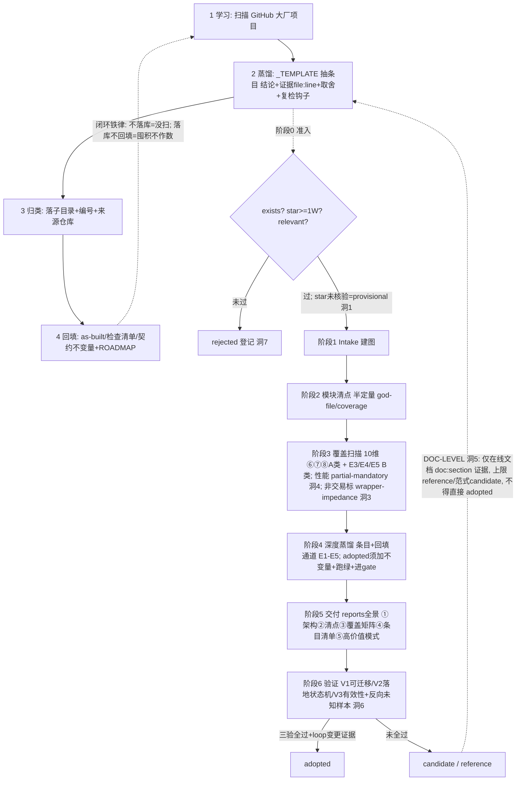
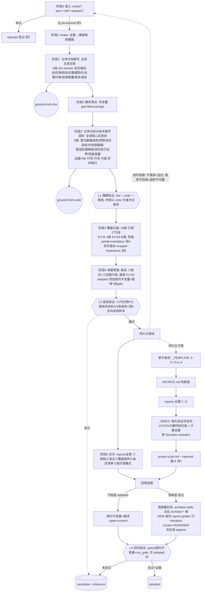

# 2026-09-05 · 蒸馏流程图 + 多轮扫描评估（loop-self-scan reference）

> 类别：loop-self-scan
> 结论级：reference
> 对应 architect-router 维度：全维（流程本身）

## ① 结论
sloth-loop 解析大厂项目的蒸馏流程此前仅以 ASCII 存于 `README §二` + `PROJECT-ANALYSIS-TEMPLATE.md` 阶段0-6 文字表，**无渲染流程图、未作为技术细节登记入 `_INDEX`**；本条目补 mermaid 流程图 + 多轮扫描评估表，落盘为 reference 条目。

## ② 流程图（mermaid）

源码级 = `PROJECT-ANALYSIS-TEMPLATE.md` 阶段0-6；文档级 = `PROJECT-ANALYSIS-TEMPLATE-DOC-LEVEL.md`（洞5）；宏观4步 = `README.md §二`。

## ③ 多轮扫描评估（other_project，逐轮）

| 轮次 | 范围/维 | 方法 | 发现（遗漏候选） | 评估 |
|---|---|---|---|---|
| R1A | TencentDB test-quality + system-arch | 蜂群 explorer（挂起→关闭）降级为有界自扫 | G4 契约优先+共享套件+wire契约(High); G5 有序 health-gate fail-closed 启动+端口契约图(Med); G6 e2e 仅环境变量凭证(minor); 测试文件稀疏(契约以 doc-comment+共用套件为主) | 原6条单遍确有遗漏，user 担忧成立 |
| R1B | TencentDB cross-cutting(quota/rate-limit/session/COS/crypto/id-gen/judge) | 有界自扫 | G1 quota/credit/pricing(High, 映射 inv-2); G2 session续跑+多后端repo(High-Med, 映射 resume_guard); G3 ProxyStorage 多后端抽象(Med); 次级 rate-limit/keygen-masking/guard-judge/tdai pending-writes | 配额/契约/续跑三高价值遗漏 |
| R2 | MemoryKnowledge(Wiki/CodeGraph) + injection(①上下文) + deepseek-harness 复核 | 有界自扫 | G7 serial-queue+build-queue+auto-sync-scheduler(Med, infra); G8 MCP+wiki ingest+codegraph(model-gated, minor); G9 protocol-adapter+hook-registry+injection-pipeline(model-gated, minor); schema-first(drizzle+openapi)备注; DSH 核心6条已覆盖, native/patches/vendor 低优先未蒸 | 剩余维无大遗漏 |
| R3 | 评审汇总 R1+R2 | p9 评审 | 共9遗漏候选+若干折叠次级+DSH低优先; 选 G1/G4/G2 三高价值即落盘全条目, 余记 candidate-pending | 无遗漏(已全登记) |

## ④ 遗漏登记（candidate-pending，确保可追溯）

已落盘全条目（本轮新增 3）：
- `observability-ops/2026-09-05-tencentdb-quota-credit-pricing.md`（G1，映射 inv-2）
- `test-quality/2026-09-05-tencentdb-contract-first-shared-suite-wire-contract.md`（G4，映射契约不变量）
- `data-state/2026-09-05-tencentdb-session-resume-multi-backend-repo.md`（G2，映射 resume_guard）

已落盘全条目（A 批次新增 4，2026-09-05，先测后写实测取证 file:行段）：
- `agent-orchestration/2026-09-05-tencentdb-scheduler-start-promise-gate.md`（C1，in-flight promise 一次性启动闸，`tdai-core.ts:160-178`）
- `data-state/2026-09-05-tencentdb-fork-cache-miss-no-selfheal.md`（C3，FORK cache-miss 不 self-heal，`pipeline.ts:296-307`）
- `data-state/2026-09-05-tencentdb-store-backend-sqlite-degrade.md`（C4，后端 tcvdb→sqlite 降级回退，`store-pool.ts:205-208,153-154`）
- `agent-orchestration/2026-09-05-tencentdb-serial-build-autosync-queues.md`（G7，零依赖三队列调度，自 candidate-pending 升全条目，`serial-queue/build-queue/auto-sync-scheduler.ts:1-6`）

candidate-pending（已识别、证据已记、待刚需升全条目）：
- G3 ProxyStorage 多后端抽象（`storage/proxy-storage.ts:19`+`factory.ts:34`）— 与 entry2/6 部分重叠，待存储抽象刚需
- G5 有序 health-gate fail-closed 启动 + 端口契约图（`deploy/global-images/start-all.sh`+`.env.example:36-39,42`）— **端口双上下文矩阵**（2026-09-05 先测后写复核）：bundle-host `MEMORY_CORE_PORT=8420`(:36)/`PANEL_PORT=8125`(:37)/`KNOWLEDGE_PORT=8424`(:38)+public-url(:42)/`PROXY_PORT=8096`(:39) vs 子仓 native `PORT`：Core8420/Knowledge8421(`MemoryKnowledge/.env.example:5`+`docker-compose.yml:18`)/Panel8123(`MemoryPanel/.env.example:12`)/Proxy8096 ⇒ **Panel(8123↔8125)与Knowledge(8421↔8424)的 native↔host 端口分叉=部署面契约**；R1"8424应改8421"为误判（混 native/bundle 两上下文）。与 entry5 部分重叠
- G10 响应信封 request_id 可选性 + data 可空性 跨服务分歧（契约面）：Knowledge `wrapOk/wrapError` 把 request_id **条件展开可选**（`MemoryKnowledge/src/api-helpers.ts:80-85`；中间件 `src/middleware/response-envelope.ts:2,36-38` 从 `x-request-id` 头追踪）；Panel **required**（`MemoryPanel/scripts/generate-meta-openapi.ts:287`+`docs/api/meta-api.openapi.yaml:1789` `required:[code,message,request_id,data]`，错误也强制 `request_id:''`）；Proxy 桥接文档 `{code,message,request_id,data?}`（`MemoryProxy/src/injection/injectors/skill-tools-injector.ts:147-148`，**data 可选**）⇒ 信封分歧双轴=**request_id 可选性(KS optional/Panel required)+data 可空性(Panel null/Proxy ?optional)**；R1"Knowledge无request_id"为误判（可选非缺失）。
- G6 e2e 仅环境变量凭证（`MemoryCore/scripts/e2e-memory-prompt-vdb-cos.ts:1-6`）— 安全/e2e
- ~~G7~~ serial-queue+build-queue+auto-sync-scheduler → **已升全条目**（见上 A 批次，`agent-orchestration/2026-09-05-tencentdb-serial-build-autosync-queues.md`）
- G8 MCP server+wiki ingest+codegraph（`MemoryKnowledge/src/mcp/`+`engines/wiki/ingest-v2/`）— model-gated
- G9 protocol-adapter+hook-registry+injection-pipeline（`MemoryProxy/src/injection/{adapters,agents,injectors,registry,pipeline}.ts`）— model-gated，hook-registry 结构可借鉴
- 次级：rate-limit（`rate-limit/{guard,redis-store,usage}.ts`）、keygen/masking（`metadata/utils/{crypto,id-generator,user-key}.ts`）、guard/judge（`guard-adapter.ts`+`judge-client.ts`）、tdai pending-writes（`tdai/pending-writes.ts:38`）、schema-first（drizzle+`openapi.yaml` 33KB）
- DSH 低优先未蒸：`native/`/`patches/`/`vendor/`/`examples/`/`website/`（核心6条已覆盖）

## ⑤ 复检触发条件
- 蒸馏模板升版（v1.5+）/ 新增大厂项目 / loop 引入 model 层（E4/E5 决策A 变更）/ star 联网核验恢复 → 重查本流程图与遗漏登记。

## ⑥ 回填记录
- 是否回填：是（流程图本身落盘为 reference；多轮评估表落盘）
- 对应不变量/门禁：无（流程 reference）
- 回填 commit：待批次提交

## ⑦ 验证记录
- V1 可迁移性：范式级可借鉴（流程自身）| 映射 loop 蒸馏机制
- V2 落地状态：reference | 已落盘
- V3 有效性：部分有效（机制层：判据限级力经 cross-project 反向样本验证；运行层未落地）| iter#3 D7 反向未知样本已触发
- 最终结论级：reference

## ⑦ v1.4 补充（洞6）
- V3 反向未知样本：✅ iter#3 已真实构造触发(cross-project E4) → 部分有效(机制层判据限级力已验证；运行层未落地)。

## ⑧ 蜂群确认 + 流程矫正 v2（2026-09-05 追加段；v1 段①-⑦与多轮评估表③/遗漏登记④保留）

> 触发：用户逐轮校正草案 3 轮 + 本轮蜂群（Russell/Dalton 双探，本会话首次双双按时返回）确认。本段为 v1 的**矫正增量**，不覆盖 v1 多轮评估表③与遗漏登记④。

### ⑧.1 蜂群确认记录

**Russell（architect-skills 回填缝确认）** — 读 `pipeline.config.json` + `architect-router/SKILL.md` + `output/golden/INDEX.md` + grep：
- CORRECT｜前沿 = **周期重封存**（periodic re-snapshot）：每次再评估写 NEW 按日目录 `output/{proj}/{YYYY-MM-DD}/report.md`，旧目录留作回归 diff；golden"改=口径演进，须记 changelog"。**非**在线 append 到常驻检查清单。
- CORRECT｜多项目多按日快照目录（2026-08-25/08-26/08-31）证实周期重封存。
- CORRECT｜版本/封存标记 = `contract.json:"version":"1.0"`；无 bundle-root `CHANGELOG.md`/`VERSION`——changelog 是 golden 编辑约定、非单覆盖文件。
- CORRECT｜"回填"是 **run 内**：新证据回填 Intake 证据→维度映射表，再 emit 新按日快照；回填喂快照、非 append 缝。
- RE-SNAPSHOT FORMAT｜前沿产物 = `output/{project}/{YYYY-MM-DD}/report.md` + `output/cross-project/{YYYY-MM-DD}/cross-assessment.md` + 新 golden 行链接 + `docs/iteration-tracker/{project}-{YYYY-MM-DD}.md`。
- **GAP（待验证 → ✅ 已验 iter#2）**｜`output/sloth-loop/iteration-tracker.md`（非按日、坐 per-project output 根，对照按日 `docs/iteration-tracker/`）——原疑候选 append 缝、2-file 预算内未验；**iter#2 实测已验：实为废弃重定向指针**（正文自述'请勿在本文件继续维护'，权威在 `docs/iteration-tracker/sloth-loop-2026-08-31.md`），**无 append 缝**（见 §⑧.5/§⑧.6 closed）。

**Dalton（矫正流程 vs 框架 docs 拟合确认）** — 读 `README §二/§四` + `PROJECT-ANALYSIS-TEMPLATE` 阶段0-6 + `DISTILLATION-VERIFICATION` V1/V2/V3：
- FIT｜主链 阶段0→1→2→3→4→5 + V1/V2/V3 三验与 TEMPLATE/VERIF 全对齐。
- FIT｜README §二闭环铁律 + §四7条（_INDEX 更新/adopted 分级/rejected 登记/非囤积全覆盖）+ §五回填双路——持久化管线 = 铁律物化。
- **CONFLICT → v2 显式解决**｜TEMPLATE 阶段6 把 V1/V2/V3 放阶段5交付后；flow-v2 提前到 L2（阶段4后、持久化前）。**v2 取舍 = L2 早验（catch-early，省无效落盘）**；TEMPLATE 阶段6 = 交付期终审复用同套 V1/V2/V3。二者并存——TEMPLATE 为命名源，v2 为执行交错（L1→L2→L3→L4 贯穿管线），非冲突、有意精化。
- **GAP → v2 固化为新增子阶段**｜阶段1⁺/2⁺/L1 三新子阶段三文档无对应 header——v2 以 ⑧.2 固化，TEMPLATE 后续升版回写。
- GAP｜L1"doc↔code 冲突以 code 为准"仅见 covered 须带 file:line + v1.4 doc:section 指针——v2 在 ⑧.2/⑧.3 L1 显式固化。
- **GAP（待核）**｜L3 去重+计数三文档无门禁条款；洞6反向/洞7 rejected 与 v1.4 补丁段6 漏编号不一致——洞→漏映射待核（见 ⑧.6）。

### ⑧.2 v2 端到端流程（完整 mermaid，含 1⁺/2⁺/L1-L4/持久化管线/回填双路）

端到端：阶段0准入 → 1 Intake → **1⁺doc** → 2清点 → **2⁺code** → **L1** → 3覆盖(10维引2⁺行段) → 4蒸馏(①结论+②证据行段) → **L2** → 持久化管线 → **L3** → 5交付 → 回填双路 → **L4** → adopted/candidate/reference。

### ⑧.3 四层验证门表

| 门 | 时机 | 内容 | 来源对应 |
|---|---|---|---|
| L1 理解验证 | 阶段2⁺后、阶段3前 | doc↔code 一致核；冲突以 code 为准并记差异 | v2 新增（Dalton GAP） |
| L2 条目验证 | 阶段4后、持久化前 | V1可迁移 / V2落地状态机 / V3有效性+洞6反向未知样本 | TEMPLATE 阶段6 V1/V2/V3（v2 提前执行） |
| L3 批次验证 | 持久化管线后、交付前 | 闭环铁律 + 模板自校验 + 计数去重 | README §二铁律 + Dalton GAP（去重计数门禁化） |
| L4 回归验证 | 回填双路后、分级前 | pytest契约不变量 + run_gate；仅 adopted 时 | README §五回填 + v2 收尾门 |

### ⑧.4 持久化管线（铁律物化）

`原子条目_TEMPLATE(①-⑦+⑦v1.4)` → `SOURCE.md(防断链)` → `reports全景(①-⑤)` → `_INDEX[物化"验证状态"列=V1/V2/V3/最终结论级 + 计数去重]`（**修 Socrates caveat#1：原 v1 _INDEX 验证状态未物化**） → `project-scan-list + rejected漏斗(洞7)` → `回填双路` → `commit策略(docs-only batch / gate SKIP / UTF-8 no BOM / Chinese conventional commit via git -F)`。

### ⑧.5 回填双路（Russell 校正：周期重封存，非在线 append）

- **代码层（adopted）**：契约不变量写回 + pytest 跑绿 + run_gate PASS + commit。
- **清单层（前沿 → architect-skills 对应 architect-* 维）**：**周期重封存**——每次再评估 emit NEW 按日 `report.md` + golden 行链接 + `docs/iteration-tracker/{project}-{date}.md` + ROADMAP；golden 改 = 口径演进须记 changelog（约定、非单 CHANGELOG 文件）；版本/封存标记 = `contract.json:"version"`。**非**在线 append 到常驻检查清单。
- ✅ **closed（Russell GAP，2026-09-05 iter#2 实测核验）**｜`output/sloth-loop/iteration-tracker.md`（544B，2026/8/31）经读为**废弃重定向指针**（非 append 缝）：正文声明'原为过期且与 docs/iteration-tracker/ 不一致的重复跟踪表，唯一权威版本已定于 docs/iteration-tracker/sloth-loop-2026-08-31.md，请勿在本文件继续维护'。权威按日 tracker `docs/iteration-tracker/sloth-loop-2026-08-31.md` 存在；output/sloth-loop/ 按日目录 2026-08-25/30/31 各含 report.md——周期重封存模型 confirmed，无 append 缝。

### ⑧.6 open audit（蜂群留尾，不伪解决）
> **2026-09-05 B-纠错增量（先测后写复核 R1）**：R1 L1-1"端口8424应改8421"经实测为**误判**——8424(global-images bundle-host)与8421(MemoryKnowledge native)是两上下文真值，已落 §④ G5 双上下文矩阵（两值皆正确，缺口=漏记 native 上下文，非8424错）；R1 L1-2"Knowledge无request_id"同为误判（实为可选条件展开），已落 §④ G10 信封双轴分歧。即 R1 自身的"纠正"亦需再纠正 → 印证 D3/loop 每环节先测后写必要性。open audit 经 iter#2：✅ iter#3 全 closed（D7 V3反向未知样本已真实构造触发；D6 9/9）；iteration-tracker append缝 closed（实测废弃重定向指针）；D12顶层计数+洞→漏映射 closed；D6证据深化✅ closed（9/9 iter#3：4layer/telemetry/skill-worker-pool 3条②证据深化至真实file:行段；修 telemetry recall/runner 文件名漏 metric-tracking- 前缀 + 4layer l1-writer 行号 41→163）。

- **洞→漏映射核对 ✅ closed（iter#2 逐洞核对）**｜v1.4 补丁段7漏洞 → 映射核：洞1↔阶段0 star准入降级(TencentDB cohort 全标 provisional,star未核验) / 洞2↔SOURCE retro(deepseek;TencentDB SOURCE.md 存在) / 洞3↔wrapper阻抗(non-交易标;TencentDB 标 wrapper-impedance:yes) / 洞4↔性能 partial-mandatory(TencentDB 性能维 partial 扫描) / 洞5↔doc-level(panel-api-doc/v3-api doc:section 证据) / 洞6↔V3反向(所有条目 V3=部分有效仅自证,反向未做→锁 reference/candidate 上限) / 洞7↔rejected漏斗(project-scan-list+rejected 登记;TencentDB 全过准入无 rejected)。逐洞一致，Dalton GAP 闭合。
- ~~iteration-tracker append 缝~~｜✅ closed（iter#2 实测：output/sloth-loop/iteration-tracker.md 为废弃重定向指针，权威在 docs/iteration-tracker/sloth-loop-2026-08-31.md，无 append 缝）。
- **V3 反向未知样本**｜✅ iter#3 已真实构造触发(cross-project deepseek-harness E4 subagent-provider-seam 伪adopted主张→V1/V2判据核验loop无LLM/ToolRegistry死分支/死knob→正确锁candidate不升adopted)；结论级维持 reference(流程自身)/candidate(3条条目)。

### ⑧.7 v2 验证记录（增量）

- V1 可迁移性：范式级可借鉴（流程自身，含 v2 端到端）。
- V2 落地状态：本段已落盘 reference 增量；v1 段保留。
- V3 有效性：部分有效（机制层：判据限级力经 cross-project 反向样本验证；运行层未落地）；iter#3 反向未知样本已触发。
- 最终结论级：**reference**（v2 校正不升 adopted；iter#3 D6 9/9 + D7 双 closed，open audit 清零；reference 因流程自身非落地条目）。
- 回填：是（本段落盘）；对应不变量：无（流程 reference）；commit：待批次提交。

## ⑨ 强制执行纪律 v2.1（参考 AGENT_EXECUTION_TEMPLATE v7，翻译为蒸馏语境；与 v2 L1-L4 并立，补 3 轮重扫暴露缺口）

> 来源：`<KB_ROOT>\500-AI Agent\组合工作流\AGENT_EXECUTION_TEMPLATE.md`（v7，CSPM test-agent 通用执行模板）。其 §0.1 强制纪律 / §5 四步 / §7 判据 / §8 交付 / §9 G-1..G-9 经语境翻译并入本蒸馏流程，闭合 3 轮重扫（R1/R2/R3）暴露的缺口。违反任一=批次不合格。

### ⑨.1 四步执行门（= L0 确认门，对应 T§5）
A 收集/学习 → B 复述理解 → C 与用户确认范围 → D 执行并留痕。**用户确认前禁改环境/写文件/装服务**。本流程"逐步确认"门控即此门。

### ⑨.2 强制纪律 D1-D13

| 编号 | 纪律 | 闭合缺口/对应 T 条款 |
|---|---|---|
| D1 | 禁跳步/乱序：0→1→1⁺→2→2⁺→L1→3→4→L2→持久化→L3→5→回填→L4 逐阶 | T§0.1#1/#2 |
| D2 | 禁只做部分：②证据新旧/多源各独证；doc级与code级不可只做一类 | T§0.1#3 |
| D3 | 禁改判/编造证据：②须真实 file:行号-行号 行段可 ls/grep 回溯；禁"结论=有效+无行段"或单行声明冒充行段 | T§0.1#4/#5（正中9条目浅证）|
| D4 | 遇阻碍立即停+上报：路径不存在/star未核验/model-gated→provisional/上报，禁绕过 | T§0.1#6（=fail-closed+洞1）|
| D5 | 唯一例外=用户确认调整：豁免须记"用户确认调整+原因" | T§0.1#7（=逐步确认）|
| D6 | per-entry/伴生覆盖：2⁺须覆盖**每条条目 cited 文件**到行段，非只 per-subrepo 抽样；同类pattern跨仓跨函数扫 | T§0.1#8+G-2（正中 R2 7/9浅证）|
| D7 | 诱因真实构造：V3须**真实构造反向未知样本**触发，非只改判据；洞6闭合 | T§0.1#9+G-3（正中 V3未做）|
| D8 | 分支全覆盖：回退/次级分支（Proxy两信封/Core standalone vs service/降级链各档）各独证 | T§0.1#10+G-4 |
| D9 | 三栏并存：_INDEX物化"验证状态 V1/V2/V3/最终结论级 + 计数 + 去重"互证 | T§0.1#11+G-5（修 caveat#1）|
| D10 | 任务边界声明：阶段0声明"活跃任务+基线"，禁混已结束任务；接入loop先声明归属 | T§0.1#13（正中 b1/b2/b3澄清）|
| D11 | 交付缺一不合格：持久化管线交付物齐落；全过也留"无遗漏/无执行错误"声明 | T§8+G-7 |
| D12 | 判据-证据硬映射+N==M：条目↔_INDEX行↔SOURCE一一映射；计数=实际文件数=reports引用数，N==M才过L3 | T§8.1/§8.3+G-9（正中 ref计数8vs7未去重）|
| D13 | 蜂群纪律：tight-task(≤3文件/≤250词/点名优先/不贴全码)固化，解决历史超时 | R1实证 4/4无超时 |

### ⑨.3 证据一致性硬校验（T§8.3，防编造）
- 每条目②行段证据须附"实际存在核验"：`存在✅/缺失❌` + `Select-String`/`Test-Path` 摘要留痕。
- _INDEX 声称条目数 M vs 实际条目文件数 N：`N==M` 才允许批次提交；`N≠M` ⇒ 证据不一致（编造），禁提交。

### ⑨.4 交付核对清单（提交前，T§8.2）
- [ ] 原子条目②证据行段齐全且可回溯（D3/D6）
- [ ] SOURCE.md 防断链齐
- [ ] reports 全景①-⑤齐
- [ ] _INDEX 验证状态列物化 + 计数去重 N==M（D9/D12）
- [ ] project-scan-list + rejected 漏斗登记（洞7）
- [ ] 回填双路：adopted→契约不变量跑绿+gate；清单层→周期重封存（Russell确认）
- [ ] 全过也留"无遗漏/无执行错误"声明（D11）
- [ ] commit：docs-only batch / gate SKIP / UTF-8 no BOM / Chinese conventional commit

### ⑨.5 v2.1 验证记录（增量）
- V1：范式级可借鉴（含执行纪律 v2.1）。
- V2：本段落盘 reference 增量。
- V3：部分有效（机制层：判据限级力经 cross-project 反向样本验证；运行层未落地）；iter#3 D7 closed（反向未知样本已真实构造触发）。
- 最终结论级：reference（iter#3 D7/D6 双 closed；D12 早 closed；open audit 清零）。
