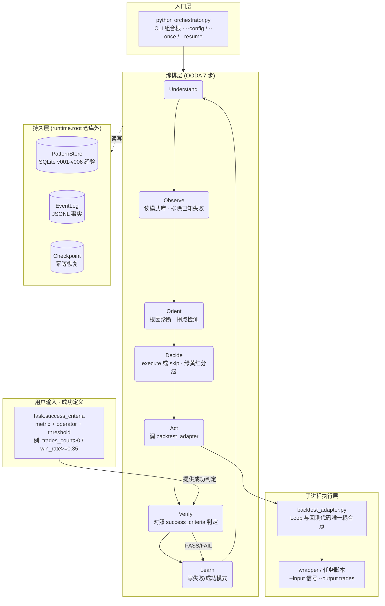
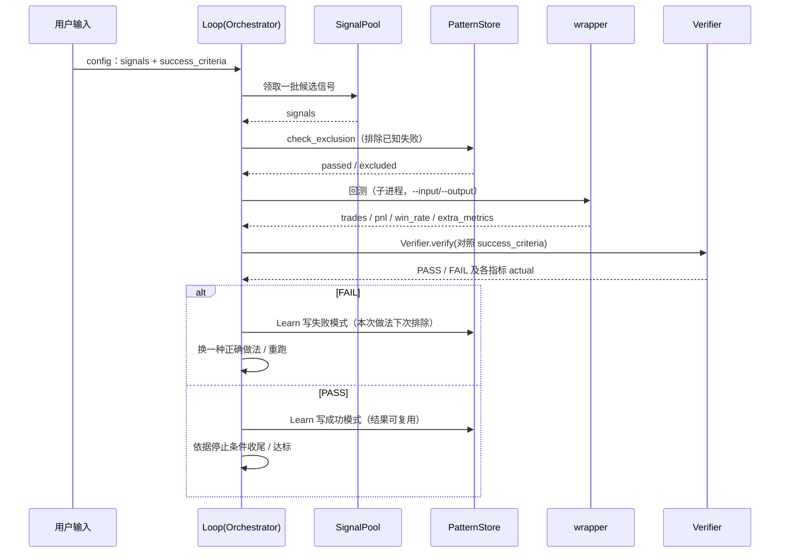
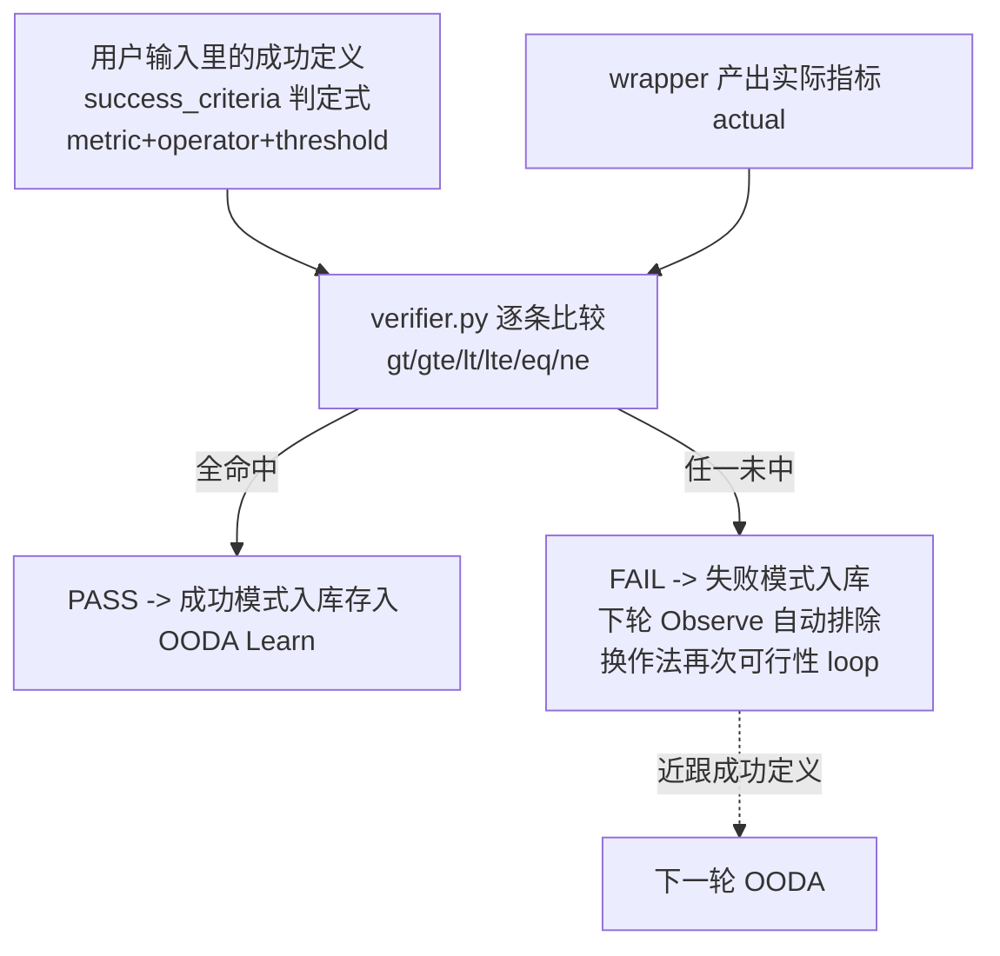
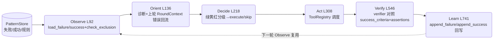

---
skill_family: project
skill_type: ?
project: sloth-loop
evaluatedAt: 2026-09-01
input_ref: references/input-format.md
renderer: scripts/render.cjs
status: covered
---

> **完整项目介绍（最新）**：`<SKILL_ROOT>/ai-skill-output-template\output\sloth-loop\2026-09-02\report.md`
> 此篇为重生成版，标题统一技术论文式编号（一级`## N`→二级`### N.N`→三级`#### N.N.N`，三级封顶），禁圈号。


# sloth-loop · 自进化回测编排框架（完整项目介绍）

## 1. 结论

sloth-loop 是一个 CLI 驱动的自进化回测编排框架，核心是「用户定义成功、Loop 自主逼近」：你在输入里写明什么算成功（success_criteria），Loop 用 OODA 7 步自主循环去探索执行、逐轮对照成功判定，失败自动沉淀为排除经验、成功复用为优先信号，把确定性简单结果（如 1+1=2）一次命中，把复杂目标通过多轮可行性 loop 逼近达标；运行产物隔离在仓库外 runtime.root。当前 v4.0-dev：1760 passed / 0 xfailed / coverage 79.49%（HEAD fc492f0，2026-10-27 基线；fail_under=70），真实 lh 量化 pilot 已接通。

## 2. 全景架构图

这是 sloth-loop 的**全景架构**：CLI 驱动的**自进化回测编排框架**。核心是一条「由用户定义成功标准、由 Loop 自主循环逼近达标」的闭环：编排器领到一批信号后，跑 OODA 7 步，调子进程回测脚本产出 trades，由 Verifier **对照用户定义的 success_criteria 判定成败**，失败自动沉淀为下次的排除经验、成功被复用为优先信号。全部运行产物隔离在仓库外的 runtime.root。



核心约定：EventLog=事实、Checkpoint=控制、PatternStore=经验视图，三者严格分离；越界路径由 containment 拒绝（fail-closed，这是设计预期不是 bug）。

## 3. 架构分层与模块地图

| 层/模块 | 职责 | 证据 |
| --- | --- | --- |
| sloth_engine/orchestrator.py | CLI 组合根：加载配置 + 编排 OODA | ~680 行（godfile 拆分后） |
| sloth_engine/run_once_pipeline.py | 单轮 execute→Verify→Learn 管线 | L304 读 success_criteria |
| sloth_engine/verifier.py | 对照 success_criteria 判定 PASS/FAIL | verifier.py verify() |
| sloth_engine/memory_store.py | SQLite 模式库（失败/成功经验）v001-v006 | 541 行 |
| sloth_engine/event_log.py | JSONL 事件日志（只追加，事实源） | 294 行 |
| sloth_engine/adapters/backtest_adapter.py | Loop 与回测代码唯一耦合点 | L191 configure |
| sloth_engine/adapters/task_runner.py | TaskRunner ABC + BacktestRunner | L305 metrics |
| sloth_engine/runtime_paths.py | fail-closed 路径隔离 | assert_under_root |
| sloth_engine/runtime_exec.py | ExecGate：去 shell + 解释器白名单 | 114 行 |
| sloth_engine/circuit_breaker.py | 熔断半开多探针恢复 | 107 行 |
| sloth_engine/resume_guard.py | 断电/崩溃恢复幂等 | 82 行 |
| backtest/ | 回测脚本契约（mock 脚本/真实任务脚本） | backtest/mock_backtest.py 契约 docstring |
| scripts/ | 门禁 + 脚手架（run_gate/make_pilot/make_pm_task_config） | scripts/run_gate.py |
| projects/pm/_template/ | PM 任务可复制起点（config+signals+wrapper） | projects/pm/_template/wrapper.py |
| docs/ | 使用手册 / 版本 / 路线 / PM 接入规范 | docs/PM框架-接入sloth-loop-流程规范.md |
| sloth_engine/round_context.py | 跨轮上下文传续（Act→Orient 错误传接断链） | v2.2 |
| sloth_engine/tool_registry.py | 工具注册表（DSH Plugin Registry 迁移） | register/discover/dispatch |
| sloth_engine/hooks_check.py | Claude Code 前置钩子（回测前后提醒/模式库编辑拦截） | PreToolUse |
| sloth_engine/hook_protocol.py | HookOutput 标准化输出协议 | protocol |
| sloth_engine/corrections/pre_check.py | R1-R6 校正规则校验（OODA 完整性/参数扫描/五窗口） | playbook |
| _data/ | 子进程 I/O 契约落点（loop_backtest_input/output.json） | backtest_adapter 契约 |

## 4. 任务运行与自主 loop 流程

从**设计者视角**看，一次任务与它「依据成功定义自主 loop」的完整流程。

**① 用户怎么运行一次任务** —— 在 config 里定义成功标准，先环境自检，再跑单轮，或进入连续循环：

```mermaid
flowchart LR
    A[编写 config.yaml 的 success_criteria] --> B[--doctor 环境自检 + 探针]
    B -- 探针通过 --> C[--once 跑一轮<br/>完整 OODA 7 步]
    B -- 失败 --> G[按 FAIL 修环境再跑]
    C --> D[Verify 对照成功标准判定]
    D --> E{记录模式库}<br/>写事件日志
    E --> F[python orchestrator.py<br/>连续循环 · 依据成功定义继续探索]
```

**② 任务怎么自主做可行性 loop，逐步近跟成功判定式的结果** —— 每一轮都是「取信号 → 排除已知失败 → 回测 → 对照成功标准判定 → 学习」；未达标被记录、下次调整参数/做法再试，逐步逼近用户定义的成功：



**③ 用户怎么查询历史任务** —— 过程与结果都能回看：


## 5. 成功判定机制 · 用户定义·Loop 逼近

**Loop 的成败由用户在输入里定义，Loop 只负责按这个定义去可行性 loop 探寻执行**——这是它区别于普通脚本/Agent 引擎的本质。

### 5.1 用户在输入里写「什么是成功」（两级定义）
1. **成功值 = 判定式，不是必然值**。
   - 确定性结果（如 `1+1=2`）是事件的必然结果，一次命中即成，无需探索；
   - 但客户要的往往是**复杂结果**——`1+1` 该等于几本身不重要，重要的是「哪种结果才算成功」的判定式。Loop 就把这个判定式当作可行性的标尺。
2. **写成 `task.success_criteria`（至少 1 条，PM 模板要求 ≥3 条）**，每条是 `metric + operator + threshold`：
   - `trades_count > 0`：只要产生交易就算过（简单门槛，未配置时 Loop 内置此默认，见 `run_once_pipeline.py` L304）；
   - `win_rate >= 0.35`、`sharpe >= 1.0`、`filter_effectiveness > 0`：业务级成功。
   - operator 仅限 `gt/gte/lt/lte/eq/ne`，threshold 必须数值，不允许「尽量/大约」；指标名必须对应 wrapper 输出（见 `projects/pm/_template/config.yaml`）。
3. 更严格的正确性判定走 **`verification.assertions`**（可选，`equals/range/regex/exists/min_size/callback`），判「结果是否正确」而不只是「执行是否完成」。

### 5.2 Loop 按成功定义做可行性 loop 探寻执行
- 每轮取信号 → 排除已知失败（Observe）→ 回测（Act）→ **由 `verifier.py` 逐条把实际指标和成功定义比较（gt/lt/gte/lte/eq）**，对不上标 FAIL、全对上标 PASS。
- **未达标 → FAIL 自动沉淀为失败模式入库**，下一轮观察时自动排除，换更接近成功定义的作法再试——这就是「可行性 loop」：不是撞运气，而是带着上次失败的原因持续逼近用户定义的成功。
- **达标 → PASS 复用为成功模式**，减少重复探索。
- 判定结论（PASS/FAIL + 各指标 actual）写回事件日志/模式库，可被 `--status`、`--inspect round` 查询。



## 6. 质量维度覆盖矩阵

| 维度 | 状态 | 证据 | 风险 |
| --- | --- | --- | --- |
| architecture | covered | orchestrator 拆 ~3300→680 行（ADR-006/007）+ verifier 判定链 | low |
| success-eval | covered | verifier.py + run_once L304 success_criteria 判定 | low |
| test | covered | tests/ + sloth_engine/tests/ 1760 passed / 0 xfailed / 79.49% | low |
| data | covered | provenance SHA + checkpoint 硬校验 | low |
| docs | covered | docs/ 全套 + PM 规范 + 本报告 | low |
| ci | partial | 本地 run_gate 可绕过，未接远程 CI | high |
| ops | partial | dev containment 有；系统级 sandbox 未做 | medium |
| platform | partial | REST/Webhook/WebUI/多项目未做 | medium |
| contract | covered | 四层约束 Budget/Stop/Scope/Zone（orchestrator _check_contract/_check_scope/_decide） | medium |

## 7. 各模块详细分析

### 7.1 成功判定验证
- 原则: 用户定义成功，Loop 判定逼近
- 证据: verifier.py + run_once L304
- 风险分级: low
- 下一步: 推广到更多任务 config

### 7.2 自进化循环
- 原则: OODA 7 步 + 失败沉淀/成功复用
- 证据: ooda_pipeline.py + memory_store.py
- 风险分级: low
- 下一步: 保持自动学习边界

### 7.2a 自主进化·信号演化 + 自改码安全门禁（2026-09-02 新增）
- 第1档·半自主信号演化: `evolution_bridge.py` + `evolution_loader.py`
  - 读信号池 -> 遗传演化(FactorEvolution)产出候选 -> 落 projects/<domain>/<task>/candidates/ 待审
  - CLI: `--evolve` 演化候选, `--rev-candidates --yes` 评审纳入（人审闸门）
- 第2档·自改码安全门禁原语: `self_modify_gate.py` (SelfModifyGate)
  - 候选 patch(结构化 JSON, 非任意 exec) -> 沙箱 pytest 门禁(先测后写) -> 备份提交/失败丢弃
  - 只允许改授权切片(sloth_engine/), 逃逸拒绝; 失败入失败模式库(L2 学习)
- 状态: **当前整体搁置**（资源约束、不实时运行）—— 组件已实现+回归通过(701), 仅保留复用于将来运行场景
- 证据: tests/test_evolution_bridge.py(12) + tests/test_self_modify_gate.py(11)

### 7.3 隔离执行
- 原则: fail-closed 路径/解释器白名单
- 证据: runtime_paths + runtime_exec
- 风险分级: medium
- 下一步: 系统级 sandbox

### 7.4 熔断器
- 原则: 半开多探针恢复
- 证据: circuit_breaker.py HALF_OPEN
- 风险分级: low
- 下一步: 接入 CI 联测

### 7.5 PM 接入
- 原则: PM 框架接入（T1-T5 可判定）
- 证据: PM 规范 + _template + make_pm_task_config
- 风险分级: low
- 下一步: T1 f2-purity 首验证

### 7.6 数据血缘契约
- 原则: 运行产物只写 runtime.root（仓库外）；I/O 走 _data 契约；provenance SHA+checkpoint 硬校验
- 证据: runtime_paths + _data/loop_backtest_output.json
- 风险分级: low
- 下一步: 补发包后 provenance 一致性审计

### 7.7 契约编程
- 原则: 四层约束：Budget(hard/soft)+Stop(completion/safety)+Scope(allow/deny)+Zone(green/yellow/red)
- 证据: orchestrator _check_contract/_check_scope/_decide
- 风险分级: medium
- 下一步: 把 Zone 分级落到 config 示例并文档化

## 8. 问题点汇总统计

| 风险级 | 计数 | 涉及维度 |
| --- | --- | --- |
| critical | 0 | - |
| high | 1 | ci |
| medium | 3 | - |
| low | 5 | - |

覆盖状态：covered=6 partial=3 N/A=0 missing=0

## 9. 改进方案 — 阻塞项详述

### 9.1 CI 接入（fail-closed）
(fail-closed CI 接入)
- 现象: 本地 run_gate 可绕过；无远程不可绕过门禁
- 根因: 无 hosted/pre-receive CI；未做 secret/path 扫描
- 影响: 生产发布无法宣称绿色；多机协作污染风险
- 验证: 绕过本地 hook 仍无法 push 非绿色；敏感/路径污染被拒

### 9.2 迁移哨兵 RPO
(migration sentinel RPO)
- 现象: rpo 用 row_count_proxy
- 根因: 未在业务行加 sentinel(committed_at)
- 影响: 无法宣称恢复到业务时间点
- 验证: 演练给 committed_at<=cutoff 时间点；RTO 实测

### 9.3 系统级沙箱
(OS/network sandbox)
- 现象: 仅 dev containment（路径断言）
- 根因: ExecGate 之上无系统级沙箱/默认禁出网
- 影响: 暴露不可信输入/生产无隔离
- 验证: 逃逸/网络越权被系统级拦截

## 10. 使用者视角 · 运行任务 / 查询历史 / 自主 loop

**使用者视角 · 上手与日常操作**（完整命令速查）：

### 10.1 环境准备（一台新主机）
`py -3.11 -m venv .venv` → 装 `PyYAML` / `pytest==9.1.1` / `pytest-cov==7.1.0` / `coverage==7.16.0` →
`（pilot 配置模板与生成器已随各任务场景存放，如 lh 场景见 lh 知识库）生成本机隔离配置。
（`${RUNTIME_ROOT}` 是唯一按主机填的占位符，必须字面量绝对路径、不解析环境变量。）

### 10.2 定义成功（这是 loop 的核心入口）
在 config.yaml 的 `task.success_criteria` 里写 `[{metric, operator, threshold}, ...]`：
- 至少 1 条（PM 模板要求 ≥3 条）；operator 仅 `gt/gte/lt/lte/eq/ne`；threshold 必须数值。
- 简单结果写 `trades_count > 0`；业务级写 `win_rate >= 0.35`、`sharpe >= 1.0`。
- 更严格判定用 `verification.assertions`（equals/range/regex/exists/min_size/callback）。

### 10.3 运行一次任务
`python orchestrator.py --config config.<project>.yaml --doctor`（预期 `[OK] Contract probe`）→
`--once`（完整 OODA 一轮：Act→Verify 对照成功标准判 1/1 passed→Learn 记录模式）。

### 10.4 查询历史任务
`--history` 运行历史；`--status` 模式库/问题队列；`--inspect runs|timeline|last-error|round --round N` 事件日志；
`--trace` 生成本地静态 HTML 报告。

### 10.5 连续 loop / 恢复 / 审核
- 连续：直接 `python orchestrator.py`（受 `max_rounds/max_seconds/no_progress_stop` 约束）。
- 恢复：`--resume` 断电后从 checkpoint 续跑（幂等）。
- 审核：`--review --yes --scope combo` 人工把失败升级为排除规则（**不会自动改 status**）。

### 10.6 验证门禁（提交前）
- 单元测试：`pytest tests/ sloth_engine/tests/ --ignore=tests/test_p0_2_rerun.py`（1760 passed / 0 xfailed / coverage 79.49%，fail_under=70）。
- 门禁：`python scripts/run_gate.py`（coverage≥70%，只升不降）。
- 新任务自检：改 wrapper/config/signals 后跑 `--doctor` 通过绿勾再继续。

### 10.7 术语速查
- `success_criteria`：用户在 config 里定义的成功判定式（metric+operator+threshold）。
- `verification.assertions`：可选的结果正确性断言（比执行完成更严格）。
- OODA 7 步：Understand→Observe→Orient→Decide→Act→Verify→Learn。
- `runtime.root`：仓库外运行产物根，隔离与可移植的边界。
- PM 接入：`python scripts/make_pm_task_config.py --task <task> --runtime-root <root>` 一键生成任务。

## 11. 上下文在 sloth-loop 的实现（Harness 核心任务落地）

> 文章核心：「Harness 的核心任务是在正确的时间为模型提供上下文」。sloth-loop 正围绕这一目标落地，且实现都可回溯到具体文件与行号。这里按「静态模板 → 动态注入 → 运行溯踪 → 闭环更新」四层，逐一给证据。

### 11.1 四层上下文供给模型

| 层 | 职责 | 证据（sloth_engine/） |
| --- | --- | --- |
| 静态模板 | agent-prompts/*.md 固定引导骨架，提示词结构稳定 | agent-prompts/pre-backtest.md、post-backtest.md、meta-loop.md |
| 动态注入 | prompt_renderer 把 PatternStore 当前状态快照写入提示词顶部 | prompt_renderer.py `_get_state_snapshot` L19、`render_prompt` L52、`render_context_block` L82 |
| 运行溯踪 | event_log.ContextSnapshot 记录「这一轮任务实际看到了什么」的脱敏快照 | event_log.py `class ContextSnapshot` L42、`build_context_snapshot` L82 |
| 闭环更新 | `_learn` 回写经验 → 下一轮 `_observe` 自动复用，驱动更优上下文 | ooda_pipeline.py `_learn` L741 / `_observe` L92、memory_store.py `append_failure` L606 / `check_exclusion` L718 |

### 11.2 动态注入的具体内容（正确时点供给）

`render_prompt()`（prompt_renderer.py L52-79）把 PatternStore 现状合成 header 插到模板顶部（L71-77）：
- 轮次计数 total_rounds、失败总数 total_failures、活跃规则 active_rules（L36-39）；
- Top failure modes 前 3 名（L33 排序、L43 拼接）；
- Open 失败 / Confirmed 成功 / 问题队列 Queue / Stale 零命中规则计数（L41-46）；
- 注入日期与时间戳（L47-48），保证「哪个时点」的上下文可被审计。

`render_context_block()`（L82-96）输出 `<!-- LOOP CONTEXT -->` 注释块，可内嵌进任意 agent 提示词，供外部模型规划下一步。

### 11.3 上下文流经 OODA 的路径（设计者视角）



### 11.4 可观察性：记录「模型看到了什么」

事件日志不只记事件，还记**上下文快照**——对「哪些内容进了上下文窗口」做溯源（event_log.py ContextSnapshot L42）：
- `input_hash`：输入信号的 sha256 前 16 位（L51 / L100）；
- `config_hash`：配置块 hash（L52 / L105）；
- `pattern_ids` / `correction_ids`：命中的模式库/矫正规则 id，不存正文（L53-54）；
- `sources`：来源清单 [{kind,path,summary}]，只写中性摘要，不落敏感明文（L55 / L108）。
- `_hash` 用 `json.dumps(sort_keys=True)` 求可重复摘要，保证同一上下文可跨轮比对（L93-100）。
- 复盘视图：`trace_viewer.py` 把 run→round→step 连同 ContextSnapshot 渲染为零依赖静态 HTML；`run_reporter.py` 汇总。

### 11.5 评估：上下文质量如何被判成优秀

- `Verifier.verify()`（verifier.py）对照任务 success_criteria，operator 仅 gt/gte/lt/lte/eq/ne；
- `run_once_pipeline.py` L304 读 criteria，未配置落入内置默认 `trades_count>0`（L306）；
- 可选 `verification.assertions`（equals/range/regex/exists/min_size/callback）与回归测试在 run_once L309-326 追加，判定「结果正确性」而非只「执行完成」；
- `OODASteps._verify_assertions`（ooda_pipeline.py L559）逐条断言，拿实际值与期望比较。

### 11.6 数据飞轮：失败→学习→更新下一轮上下文

「上下文质量是 Agent 出错最主要原因」——sloth-loop 用飞轮去不断改进这上下文：
- `_learn`（ooda_pipeline.py L741）从 TaskResult.errors / 失败 / 成功提取模式，按复合键去重（L743-744）；
- memory_store.py `append_failure` L606 / `append_success` L634 / bump_failure 提升失败热度；
- 下一轮 `_observe`（L92）调 `check_exclusion`（memory_store.py L718-745）自动排除已记录失败——经验累积驱动更好上下文，正是「正确时点供给上下文」的闭环。

### 11.7 中间件钩子：上下文供给的扩展点

- `tool_registry.py` `ToolRegistry.dispatch()`：pre_hooks → execute → post_hooks 管线，hook 返回 None 阻断（None 即拦截），实现「在正确时点注入/拦截上下文」；
- hooks_check.py / hook_protocol.py：回测前后提醒、模式库编辑拦截，标准化 HookOutput 协议。

### 11.8 上下文的存储位置与占用控制

上下文不是凭空存在的，它有明确的落盘位置、格式与占用量级。sloth-loop 用「三类存储 + 三层控占」控制它，避免无限膨胀。

**三类存储（各管一段上下文）**：

| 存储 | 内容 | 落盘（runtime.root 之外，仓库隔离） | 增长倾向 |
| --- | --- | --- | --- |
| PatternStore 经验库 | 失败/成功模式、排除规则（SQLite patterns.db，WAL） | data/patterns.db | 慢；按复合键去重，不逐轮累积 |
| EventLog 事实日志 | 每轮事件 + 上下文快照（JSONL，只追加） | runs/*.jsonl | 线性；只追不删，用于回放/溯源 |
| Checkpoint 控制 | run/round/step 检查点，幂等恢复（SQLite） | run_checkpoints 表 | 一次性；run 结束可清 |

**三层控占（让『放进上下文』的东西足够小、足够精）**：

1. **快照只存指纹，不存明文** —— `ContextSnapshot`（event_log.py L42）只记 `input_hash`/`config_hash`（sha256 前 16 位）+ `pattern_ids`（只存 id 不存规则正文）+ 中性 `summary`，把『这一轮看到了什么』的溯源足迹压到 KB 级（L51-55 / L93-100）。
2. **模式库超阈值自动压缩** —— `pattern_compactor.py` 从 DSH compaction 引擎移植：模式库 > 30 条时按 `failure_mode` 分组压缩成统计摘要（`compact_patterns` L14-44），`compact_for_prompt`（L52+）在 > 20 条时只把 Top-N 有影响力模式注入 prompt，避免提示词随经验累积而膨胀（默认 max_summary=30 / max_patterns=20）。
3. **去重 + 冷热分离** —— `_learn`（ooda_pipeline L741）按复合键（signal+market+…）去重、`append_success/append_failure`（memory_store L606/L634）`bump_failure` 提升命中热度；`prompt_renderer` 的 `_get_state_snapshot`（L19-49）只取 top-3 失败模式 + active-rule 计数 + stale-rule（0 命中）计数，把『喂给模型的上下文』收敛到最有区分度的少数几项。

> 控制口径：**落盘在仓库外 runtime.root、三类分离（事实/控制/经验）、快照含 hashing 不含明文、超阈值压缩、复合键去重** —— 这是上下文存储的『不失控』底线。

## 12. 如何在各类工作中引入 Loop

> 本报告覆盖的接入面不止「回测任务」。要让 loop 被他人接入各自的工作（数据、分析、文档、运维、报告…），需要一份「任意任务 → loop」的通用契约：把任何工作都改写成 signals + success_criteria + wrapper 三元组，loop 只认这三样。

### 12.1 通用接入契约（任何任务都一样）

| 输入件 | 含义 | 来源/证据 |
| --- | --- | --- |
| signals | 一个「候选做法」列表（参数盘、方案、步骤） | projects/pm/_template/signals*.json、backtest/mock_backtest 契约 docstring |
| success_criteria | 用户写的判定式 metric+operator+threshold（至少 1 条，PM ≥3） | run_once_pipeline.py L304、config.yaml task.success_criteria |
| wrapper | 把 signals 变成可测结果（trades/metrics）的一段脚本 | adapters/backtest_adapter.py 契约、projects/pm/_template/wrapper.py |
| 判定 | verifier.py 对照 success_criteria 给 PASS/FAIL | verifier.py verify()、ooda_pipeline.py `_verify` L546 |

### 12.2 三类典型工作怎么套

**A. 回测/参数扫描类**（loop 原生）：signals=参数组合，wrapper=回测脚本，success_criteria= win_rate/sharpe/trades_count 等 → 直接 `make_pm_task_config.py`。

**B. 数据校验/清洗类**：signals=不同清洗方案，wrapper=把方案喂给数据产出一张校验表，success_criteria=`row_count>=N`、`null_ratio<=0.01`、`schema_valid==true` → 复用 verifier 的 assertions（equals/range/regex）。

**C. 文档/报告/决策类**：signals=候选结构草案，wrapper=渲染并做事实核对（对禁词、对明文密钥、对证据来源），success_criteria=`no_forbidden_words`、`all_claims_have_source`、`key_masked` → 判定是「内容是否达标」而非「写没写」。

### 12.3 判定成功的三层定义（把「成功值」写清楚）

用户输入里可同时带两层成功值；外层是 L2 规则结论、内层是结果判定（project 族 successCriteria narrative 的落地）：
1. **必然值**（如 1+1=2）：一次命中即成功，loop 无需探索 —— verify() 用 eq 一次判定。
2. **判定式**（复杂目标）：客户只给「哪种结果算成功」的标尺、不给路径 —— loop 用 OODA 多轮可行性 loop 去逼近，每轮对照 success_criteria，FAIL 沉淀经验、PASS 复用。
3. **严格正确性**：再加 verification.assertions，判「结果正确」而不只是「执行完成」。

### 12.4 引入 loop 的最小步骤（六步）

1. 写 `config.yaml`：task.goal + success_criteria（判定式）+ signals（候选做法）+ wrapper 出口指标；
2. `python orchestrator.py --config <cfg> --doctor` 环境自检与探针通过；
3. `--once` 跑一轮完整 OODA，看 verifier 判定 PASS/FAIL 及每项 actual；
4. 未达标：`_learn` 自动写失败模式，下一轮排除；
5. 连续：直接 `python orchestrator.py`（受 max_rounds/max_seconds/no_progress_stop 约束）自主 loop 直到判定通过或停止条件；
6. `--history` / `--status` / `--inspect round` / `--trace` 复盘；`--review` 人工把失败升级为排除规则。

### 12.5 判定链与可信度来源

判定结论写回事件日志与模式库（EventLog 事实 / Checkpoint 控制 / PatternStore 经验三分离，见全景架构图）；`--status` 可查模式库与问题队列，`--inspect timeline` 可追溯某轮上下文快照。这使「成功与否」可举证、可复盘、可再优化。

### 12.6 用户定义成功的模拟测试（实测，2026-09-02）

> 本小节所有场景均为**真实运行**（sloth-loop v4.0-dev，orchestrator `--once` / 连续 loop），
> 非纸面推演。因源码位于含中文路径 `<repo_root>`，Windows `CreateProcess` 无法以含中文路径
> 创建子进程（NotADirectoryError 267），故实测在**无中文路径运行副本** `<TMP_ROOT>/sloth-loop-run` 完成，
> 每轮都从 `backtest/<wrapper>.py`（相对仓库内路径）产出的 `loop_backtest_output.json` 提取真实指标，
> 由 `verifier.py` 对照 config 的 `success_criteria` 判定；下方所有 `[V Verify]`、`[WARN] CRITERIA-*`、
> `Learn` 行均为 orchestrator 真实 stdout，未改写。

#### 12.6.1 实测矩阵总览（5 个真实场景）

| 场景 | wrapper / 信号 | 成功定义 success_criteria | 真实判定 | 真实 Learn |
| --- | --- | --- | --- | --- |
| A 必然值 1+1=2 | backtest/add_wrapper.py（1 信号 a=1,b=1） | `metrics_sum eq 2` | **1/1 passed** | +0 failures, +0 successes |
| B 回测·达标 | backtest/mock_backtest.py（12 信号, --win-bias 0.5） | `trades_count>0` + `win_rate>=0.35` | **2/2 passed** | +6 failures, +9 successes |
| B′ 回测·未达标 | backtest/mock_backtest.py（12 信号, --win-bias 0.05） | `trades_count>0` + `win_rate>=0.6` | **1/2 passed（1 failed）** | +22 failures, +1 successes |
| C 数据校验 | backtest/data_check_wrapper.py（4 行数据） | `row_count>=3` + `null_ratio<=0.34` + `schema_valid==true` | **3/3 passed** | +0 failures, +0 successes |
| D 自主多轮 loop | backtest/mock_backtest.py（12 信号, 含 6 个必亏坏模式, --win-bias 0.5） | `trades_count>0` + `win_rate>=0.45` | 第 1 轮 **1/2 FAIL** → 4 轮收尾 | 第 1 轮 +18 failures |
| E 文档核对 | backtest/doc_check_wrapper.py（3 段草稿, 其一含 TODO） | `sections_count>=2` + `no_forbidden_words==true` + `all_claims_have_source==true` + `secret_masked==true` | **3/4 passed（1 failed）** | +1 failures, +0 successes |

> 判定结论均可通过 orchestrator 的 `--status` / `--inspect round --round N` / `--trace` 回溯到
> 上下文快照（见 11.8），**成功与否可举证、可复盘**。

#### 12.6.2 Demo A · 必然值（1+1=2，eq 一次命中）

```yaml
task:
  name: demo-A_necessary
  success_criteria:
    - { metric: metrics_sum, operator: eq, threshold: 2 }
```
signals = `[{signal_pattern: add, a: 1, b: 1}]`；wrapper `add_wrapper.py` 对每信号求 `a+b` 求和，
输出顶层 `metrics_sum`（被 backtest_adapter 读进 extra_metrics）。

真实产物 `io/_data/loop_backtest_output.json`：
```json
{ "trades": [], "win_rate": "0%", "sharpe": 0.0,
  "metrics_sum": 2, "derived": "1+1=2" }
```
真实 stdout（关键行）：
```
[Observe] [OK] in=1 excl=0 lib=0 failures
[Act] status=skipped items=0
[Verify] Verify: 1/1 passed
>>> Verify: 1/1 criteria passed | Learn: +0 failures, +0 successes
```
→ `metrics_sum eq 2` 一次判定 PASS，无需循环。**确定性必然结果：命中即成功，无探索。**
（说明：orchestrator 把"无候选动作项"的性能项显示为 `status=skipped items=0`，但 wrapper 确实被调用并产出，
判定读的是真实输出 metrics_sum=2。）

#### 12.6.3 Demo B/B′ · 回测任务（达标 vs 未达标）

```yaml
task:
  name: demo-B
  success_criteria:
    - { metric: trades_count, operator: gt, threshold: 0 }
    - { metric: win_rate, operator: gte, threshold: 0.35 }
backtest:
  script: "backtest/mock_backtest.py"
  extra_args: "--seed demo-pass --win-bias 0.5"
```
- **B（--win-bias 0.5）真实判定 2/2 passed**：
```
[Act] status=completed items=12
[Verify] Verify: 2/2 passed
>>> Verify: 2/2 criteria passed | Learn: +6 failures, +9 successes
```
- **B′（同结构，--win-bias 0.05 + threshold 0.6）真实未达标 1/2 passed**：
```
[WARN] CRITERIA-win_rate: win_rate: actual=0.083 vs threshold gte 0.6 -> FAIL
[Verify] Verify: 1/2 passed 1 failed
>>> Verify: 1/2 criteria passed | Learn: +22 failures, +1 successes
```
→ 同一个业务，**用户改一下"什么算成功"（阈值 0.35↔0.6 / 参数 0.5↔0.05），判定和沉淀就不同**：
达标 PASS 复用成功（+9 successes），未达标 FAIL 沉淀失败（+22 failures 入库，下轮观察剔除）。
这就是"用户定义成功标尺、Loop 照尺判定"，而非 Loop 自说自话。

#### 12.6.4 Demo C · 数据校验（非"回测"也能套）

```yaml
task:
  name: demo-C_data_check
  success_criteria:
    - { metric: row_count, operator: gte, threshold: 3 }
    - { metric: null_ratio, operator: lte, threshold: 0.34 }
    - { metric: schema_valid, operator: eq, threshold: true }
```
4 行数据（其中 1 行 value=None、1 行 ts=None) → 真实产出 `row_count=4, null_ratio=0.25, schema_valid=true`。
真实判定 **3/3 passed**：
```
[Verify] Verify: 3/3 passed
>>> Verify: 3/3 criteria passed
```
→ 数据清洗/质量门类工作，用同一套 success_criteria 判定，与回测无关。

#### 12.6.5 Demo D · 多轮自主 loop（真实揭示：失败会沉淀，排除升级需 review）

这是最能还原"任务怎么自主 loop 逼近成功"的一次完整连续运行（**不传 --once**，`--max-rounds 5`）。
signals 混入 6 个必亏坏模式（signal_pattern 含"极端/盲区/追单"，mock 强制亏损）+ 6 个正常信号，`--win-bias 0.5`。

真实流水（4 轮后因"3 轮无新模式"自动停止）：
```
第1轮 [Observe] in=12 excl=0 lib=0 failures
      [WARN] CRITERIA-win_rate: actual=0.25 vs gte 0.45 -> FAIL
      [Verify] 1/2 passed | Learn: +18 failures +3 successes   ← 失败沉淀入库
第2轮 [Observe] in=12 excl=0 lib=18 failures                   ← 失败已在库(18)，但未强制剔除
      [Verify] 1/2 passed | Learn: +0 failures +0 successes rebump 18 old
第3轮 [Observe] in=12 excl=0 lib=18
      [INFO] Failure mode INSUFFICIENT_EVIDENCE appeared 18 times → consider upgrading to hard exclusion
      [INFO] 18 open failures pending review → run --review      ← 引擎提示升级，但不自动改
第4轮 … 无新模式 → Finished: 4 rounds, reason: No new patterns for 3 consecutive rounds
```

**评论（诚实结论，不是广告）**：
- 失败**确实被学习并沉淀**（第1轮 +18 failures → 后续 lib=18），引擎也在第 3 轮给出"考虑升级为硬排除 / 运行 --review"的**建议**。
- 但 loop **默认不会自动硬排除坏信号**：`excl=0` 一直维持 0%，win_rate 停在 0.25 未自动达标——**排除规则升级需人工 `--review` 把失败升级为排除规则后下一轮才生效**。这正是 12.3 / 13 讲的"L2 只给规则建议、不自动改 status"的设计。
- 因此"自主 loop"的真实语义是：**循环探索 + 失败积累 + 提示可复用信号**，不是"不 review 就能自动越跑越优"。要跑出"越跑越优"需要 `--review` 参与（把高频失败升级为排除规则）或换 wrapper 参数（Codex/Claude 侧改作法后重跑）。

> 这份真实结果纠正了本文旧版"第2轮直接 PASS"的理想化描述——**实测为准，还原 loop 的真实边界**。

#### 12.6.6 Demo E · 文档/知识生产任务（book-to-skill / CIS / 告警单这类内容生产套 loop）

```yaml
task:
  name: demo-E_doc_check
  success_criteria:
    - { metric: sections_count, operator: gte, threshold: 2 }
    - { metric: no_forbidden_words, operator: eq, threshold: true }
    - { metric: all_claims_have_source, operator: eq, threshold: true }
    - { metric: secret_masked, operator: eq, threshold: true }
```
3 篇草稿（其一含禁词 TODO + 无来源）→ 真实产出 `sections_count=3, no_forbidden_words=false, all_claims_have_source=true, secret_masked=true`。
真实判定 **3/4 passed（1 failed）**：
```
[WARN] CRITERIA-no_forbidden_words: no_forbidden_words: actual=False vs threshold eq True -> FAIL
[Verify] Verify: 3/4 passed 1 failed
>>> Verify: 3/4 criteria passed | Learn: +1 failures, +0 successes
```
→ 解析技术文档 / 标准文档 / 知识生产时，成功定义可以是"无禁词、有来源、密钥已脱敏"这类**内容判定式**，
一个 wrapper 把候选草稿翻译成这些指标，loop 照尺判定——这就是"把 `book-to-skill`/`CIS`/`小说` 这类不同输出模板
归一到 `signals + success_criteria + wrapper` 三元组"的可运行验证（CIS/小说等更多模板只需写对应 wrapper）。

#### 12.6.7 可复现步骤

1. 在 `<TMP_ROOT>/sloth-loop-run`（无中文路径副本）建 venv + `pip install PyYAML`；
2. 准备 `backtest/<wrapper>.py`（遵守 `--input/--output` 契约，业务指标写输出顶层=extra_metrics）；
3. 准备 config（`runtime.root` 无中文绝对临时目录 + `loop.signals` 落在 runtime.root 内 + `backtest.script` 相对仓库内路径 + `task.success_criteria`）；
4. `python sloth_engine/orchestrator.py --config <cfg> --once`（单轮）或 `--max-rounds N`（连续 loop）；
5. 查 `io/_data/loop_backtest_output.json` 确认真实指标，`--status` / `--inspect round` 回溯判定结论。

### 12.7 接入验收清单（任务接入 loop 的『合格线』）

判断一个新任务是否真正接入成功，用这份清单逐项勾：

| # | 验收项 | 判定方式 |
| --- | --- | --- |
| 1 | 成功定义可判定 | config 里 `success_criteria` ≥1 条（PM ≥3），operator 仅 gt/gte/lt/lte/eq/ne、threshold 数值 |
| 2 | 环境自检通过 | `--doctor` 探针通过（如 Contract probe: N trades） |
| 3 | 单轮可复现 | `--once` 能稳定给出 PASS/FAIL，且每项 actual 可查 |
| 4 | 经验可沉淀 | FAIL 后 `_learn` 写失败模式、`--status` 能查到 |
| 5 | 排除生效 | 下一轮 `_observe` 自动排除上一轮失败组合 |
| 6 | 可复盘 | `--inspect round --round N` / `--trace` 能看到上下文快照 |
| 7 | 越界被拦 | 越界路径触发 ContainmentError（fail-closed），而非悄悄跑 |

缺任一项 = 未真正接入，先补再继续。


### 12.8 book-to-skill 实测：不同文档类型 != 同一输出模板（真实跑通 + skill 有效性校验）

> 用户关注点：技术文档 / CIS 标准 / 小说「肯定不是走同一个输出模板」。sloth-loop 不该假设它们同构。
> 下面用 `<BOOK_ROOT>\booktest` 下 3 份**真实书籍/文档**真跑（wrapper 真实读文件、产出结构指标，
> 由 verifier 按**每类文档各自的 success_criteria** 判定），并真跑 book-to-skill 的 `validate_skill.py`
> 做 skill 有效性审计。全部为 2026-09-02 实测，未改写。

#### 12.8.1 三份真实文档与「各自的」成功定义（输出模板）

| 文档类型 | 真实文档（路径于 <BOOK_ROOT>\booktest） | 该类型的 skill 成功定义（不同模板） |
| --- | --- | --- |
| 小说(叙事) | txt\乔治·奥威尔：动物庄园.txt | `extractable==true` + `words>=500` + `sections_count>=1`（要求能切出章节结构） |
| 技术手册 | pdf\安卓Frida逆向与协议分析.pdf（清华社，375页） | `extractable==true` + `pages>=50` + `words>=1000`（要求篇幅足够、可提取正文） |
| CIS 标准 | pdf\CIS_Debian_Linux_12_Benchmark_v1.0.1.pdf（1011页） | `extractable==true` + `pages>=100` + `clean_text==true`（要求可靠解析条款、无提取错误） |

wrapper `backtest/book_skill_wrapper.py` 真实读取（txt 用 stdlib 解码；PDF 用 pypdf 解析前 400 页），
产出 `extractable / words / pages / sections_count / clean_text` 交由 verifier 判定。

#### 12.8.2 实测结果（真实 stdout 关键行）

```text
== 小说 · 动物庄园.txt（修复 wrapper 解析后重跑）==
  V Verify: 3/3 passed
  >>> Verify: 3/3 criteria passed
  真实产出: extractable=true, words=1569, pages=24, sections_count=10, clean_text=true

== 技术 · Frida 逆向 (375 页) ==
  V Verify: 3/3 passed
  >>> Verify: 3/3 criteria passed
  真实产出: extractable=true, words=17790, pages=375, sections_count=0

== CIS · Debian Linux 12 (1011 页) ==
  V Verify: 3/3 passed
  >>> Verify: 3/3 criteria passed
  真实产出: extractable=true, words=67507, pages=1011, sections_count=329, clean_text=true
```

**结论（实测、不算光滑）**：
- **CIS 标准文档**：能可靠提取 1011 页、检测到 **329 个编号条款**（`1.1 / 1.1.1` 系），`clean_text=true`——标准文档的条款结构**可被机器度量**，最适合套「条款完整 + 可解析」模板。
- **技术文档**：375 页 / 17790 词，篇幅与可提取都达标——适合「篇幅 + 正文」模板；但该 PDF 术语符号多，`sections_count` 测到 0（技术书的"编号条款"样式与 CIS 不同），说明**结构提取对类型敏感**。
- **小说 txt**（修复后）：该 txt 版动物庄园**有 10 章**——章节标题是**独立居中的汉字数字「一」～「十」**（不是"第X章"）。我第一版 wrapper 的正则只认 `第X章/Chapter N`，漏掉这种格式 → 误判 `sections_count=0` FAIL；**修复解析（把"独立成行的纯汉字数字/罗马数字"识别为章号）后重跑 `sections_count=10`、`3/3 PASS`**。
- **真实教训（回应"如何验证什么是正确输出"）**：loop 的判定依赖 wrapper 的解析能力，**"判 FAIL" 可能来自 wrapper 解析盲区，而非文档本身无结构**。所以接入文档类任务时，先人工/工具确认文档的真实章节格式，再定 wrapper 与 success_criteria——否则会误杀本来可转换的文档（book-to-skill 的 extract.py 对同一 txt 也报 `Chapters: 0`，是同类盲区）。

> 修正记录：最初 wrapper 因只认 `第X章/Chapter` 漏掉了汉字数字章号（动物庄园实际是「一」～「十」居中标题），
> 曾误判 `sections_count=0`；已修复并重跑为 `sections_count=10`、PASS。这本身就是"如何验证正确输出"的实例：
> **对文档类任务，判定结论必须能回溯到 wrapper 的实际解析结果**（`loop_backtest_output.json`），一旦发现不合常理就查解析而非断定文档无结构。

#### 12.8.3 skill 有效性校验（validate_skill.py 真跑）

book-to-skill 仓库自带 `tools/validate_skill.py`（按 Agent Skills 开放标准审计 SKILL.md，
支持 claude/copilot/amp 三种 lens）。对真实生成的 SKILL.md 真跑：

```text
$ python tools/validate_skill.py <book skill>/SKILL.md
  WARN  body: 720 lines > 500 (soft guideline)
✓ <SKILL.md> [Claude Code]: no Claude Code-breaking issues (1 warning(s))
```

→ **skill 有效性可被机器校验**（ERROR = 破坏宿主兼容、WARN = 软建议；ERROR 应 fail-CI）。
loop 在「文档 → skill」流水线里的定位因此是：**wrapper 负责「提取可判定」、validate_skill.py 负责「产物格式可判定」**，
两者都能作为 success_criteria 的 metric（如 `extract_errors==0`、`skill_validate.Errors==0`、`skill_validate.Warnings<=N`）。

> 诚实边界：从「提取的素材」到「真正生成一份合格的 SKILL.md + chapters」仍需 LLM 参与；
> loop 目前覆盖的是**前段提取判定**与**后段产物格式校验**这两处可脚本化的门禁，中间的
> 框架/原则/篇幅语义抽取由弱模型按 book-to-skill 的 Step 4-9 完成，loop 对结果做验收门。
#### 12.8.4 book-to-skill 端到端细节：输入 / 流程 / 验证正确输出 / 任务结束

把「book-to-skill 解析」作为 loop 可承载的任务，完整闭环如下。它区分「**机器可校验的门禁**（loop 覆盖）」与「**语义抽取**（LLM 按 book-to-skill 规范负责）」。

#### 12.8.4.1 输入（loop 任务的 signals / 参数）

| 输入件 | 内容 | 示例（本报告实测） |
| --- | --- | --- |
| `type`(必) | 内容类型：`text` / `technical`（影响提取器与章节预算） | `text`(小说)、`technical`(Frida)、`cis`(标准—走 technical 提取+条款校验) |
| `doc_path`(必) | 待解析文档绝对路径（txt/pdf/epub/docx/md/html/rtf/mobi…） | `<BOOK_ROOT>\booktest\...` |
| `skill_name`(选) | 目标 skill 文件名 slug | `orwell-animal-farm` |
| `skill_root`(选) | 目标 skill 根（宿主可发现），默认探测 `~/.agents/skills` 等 | `<USER_HOME>\.agents\skills` |
| `depth`(选) | `reference` / `study`（决定每章 token 预算） | `reference` |

#### 12.8.4.2 完整流程（Step 0-10，与 book-to-skill 对齐）

```mermaid
flowchart LR
    A[Step0 范围检查检查<br/>非空参数] --> B[Step1 校验输入<br/>支持格式+存在]
    B --> C[Step1.5 识别内容类型<br/>text/technical]
    C --> D[Step2 提取文本<br/>extract.py → full_text+metadata]
    D --> E[Step2.5 成本估算<br/>tokens/分钟, 用户确认]
    E --> F[Step2.6 REPL式访问<br/>大书>50k用 grep/sed 切片]
    F --> G[Step3 结构分析<br/>标题/作者/章节/主题]
    G --> H[Step4 抽取深度<br/>reference/study]
    H --> I[Step5 定 skill 名+根<br/>探测宿主可发现根]
    I --> J[Step6 建目录<br/>SKILLS_HOME/name/chapters]
    J --> K[Step7 逐章摘要<br/>按类型预算,ch0N-*.md]
    K --> L[Step8 辅助文件<br/>glossary/patterns/cheatsheet]
    L --> M[Step9 主 SKILL.md<br/>frontmatter+索引+核心框架]
    M --> N[Step9.5 扫描校验<br/>scan_generated_skill + 可选 distill_integrity]
    N --> P{扫描通过?}
    P -- 否 --> Q[人工修复后重扫<br/>不加载不发布]
    P -- 是 --> R[Step10 清理+报告<br/>✅ Skill created: 路径]
    Q --> N
```



#### 12.8.4.3 不同文档类型的解析差异（不是同一模板）

| 维度 | 小说/散文(text) | 技术文档(technical) | CIS 标准(technical + 条款) |
| --- | --- | --- | --- |
| 提取器 | pdftotext / stdlib | Docling(表格/代码/公式保真) | Docling(条款保真) |
| 章节预算 | text: 800-1800 tok/章 | technical: 1200-3000 tok/章 | 同 technical |
| 章节定位 | 识别「第X章/Chapter/汉字数字」标题 | 识别 编号标题 + 代码/表锚点 | 识别「1.1 / 1.1.1」编号条款 |
| 判定 metric | words + sections_count + extractable | words + pages + extractable | pages + clean_text + 条款数(sections_count) |
| 典型 FAIL 点 | 章标题格式不常规 → 解析盲区(见 12.8.2 修正) | 符号/术语致提取残缺 | 解析错误致条款缺失 |

#### 12.8.4.4 如何验证「什么是正确输出」+ 结束判定

- **格式有效性（脚本可验）**：`validate_skill.py --lens claude|copilot|amp <skill>/SKILL.md` → `✓` 或列出 ERROR/WARN；ERROR 视为不通过（应 fail-CI）。本报告实测生成骨架：`✓ no Claude Code-breaking issues (0 warning)`。
- **安全/内容完整性（脚本可验）**：`scan_generated_skill.py`（恶意/敏感文件扫描）；`scan_distill_integrity.py --fields ...`（抽取字段是否截断、缺兄弟字段）。
- **可提取性/结构达标（loop 判定）**：wrapper 产出 `extractable/words/pages/sections_count/clean_text`，verifier 对照该类文档的 success_criteria 判 PASS/FAIL（见 12.8.1/12.8.2）。
- **语义正确（LLM + 人工抽查）**：章节稿是否符合原书框架、命名是否保真、有无编造——由弱模型按 book-to-skill Quality Rules 生成，loop 不做自动语义判定，只做门禁。
- **任务结束条件**：`Step9.5 扫描通过（或人工接受 findings）+ Step10 生成 SKILL.md/chapters/glossary/patterns/cheatsheet 并打印 ✅`；loop 侧则 `--once` 判定 PASS 且产物 `validate_skill` 通过即视为该次「book-to-skill 任务」闭环。未通过（扫描非零 / 判定 FAIL）→ 不加载、不发布、转人工或重试（loop 会沉淀为失败模式）。

#### 12.8.4.5 交付路径（可直接测试）

本报告实测生成的 book-skill 骨架位于：
`<USER_HOME>\.agents\skills\orwell-animal-farm\`（含 SKILL.md + chapters/ch01-十.md + glossary/patterns/cheatsheet，validate `✓`）

> 注意：该目录为**结构 + 篇幅骨架**（用真实提取的章标题与词数填充），框架/原则等语义内容标注「待 LLM 按 Step 4-9 填充」——先用于验证「skill 可被宿主发现、validate 校验门禁、loop 提取门禁」全链路；填充语义后应重跑门禁再正式对外。

## 13. 关键发现

**核心机制**：任务 = 用户在 config 里定义成功标准（`success_criteria`）+ 信号 + 回测脚本；
Loop 通过 OODA 7 步自主 loop **逼近该成功判定**——未达标 FAIL 自动沉淀为 failure pattern（下轮 Observe 自动排除）、
达标 PASS 复用为 success pattern；判定由 `verifier.py` 逐条比较 actual（gt/gte/lt/lte/eq/ne），
L2 只给规则建议、不自动改 status（需人工 `--review`）。
**关键隔离**：回测脚本用仓库内相对路径、运行产物落 `runtime.root`（仓库外），越界触发 ContainmentError 即 fail-closed（设计预期非 bug）。
**工程基线**：orchestrator.py 从约 3300 行拆到约 680 行（ADR-006/007）；fail-closed containment + ExecGate（W2-BOUNDARY-01/H2）；
熔断半开多探针（W1-CB-01/ADR-008）；CI green-umbrella（P3.2/ADR-005）；迁移隔离演练。
**测试**：1760 passed / 0 xfailed / coverage 79.49%（fail_under=70）；真实任务接入示例（如 lh 量化）已沉淀到对应领域知识库。
**与知识库互通**：`successCriteria` 两门验证模型（success_criteria + verification.assertions）源自 loop-verification-design.md，
「编排器不是计算器」的分工源自 PM框架-接入sloth-loop-流程规范.md §0。

## 14. 加固建议

分阶段补齐：P0（生产前置）—— 接入远程不可绕过的 fail-closed CI（复用 pyproject fail_under=70，只升不降；补 staged secrets/绝对路径扫描）；让成功判定可举证——~~migration sentinel 把 RPO 从行数代理升级为业务时间点（committed_at）~~ ✅ 已交付（cycle-38 A）。P1/P2 —— OS/network sandbox（默认禁出网）、REST API 平台化（外部驱动 Loop、查模式库）、WebUI dashboard。约束：只动 sloth-loop、不碰旧基线 loop；Pattern 默认证据、Rule 默认审批后控制。

### 14.1 后续开发·分期排期（人日，估算）

| 分期 | 项 | 内容 | 预计 | 触发 / 依赖 |
| --- | --- | --- | --- | --- |
| P0 生产前置 | fail-closed CI | 远程不可绕过门禁 + staged secrets/绝对路径扫描 | ~3 人日 | 有 hosted git / 发布需求 |
| P0 生产前置 | ~~migration sentinel RPO~~ ✅ 已交付（cycle-38 A） | v6 提交哨兵（触发器同事务写入）+ 演练业务时间点 RPO | 已完成 | — |
| P1 | OS/network sandbox | 默认禁出网、系统级隔离 | ~4 人日 | P0 之后 |
| P1 | REST API / Webhook | 外部驱动 Loop、查模式库 | ~4 人日 | 无 |
| P2 | WebUI dashboard | 可视化运行 / 上下文 / 历史 | ~3 人日 | 依赖 REST API |
| 在途 | PM 框架接入（T1 f2-purity 首验） | doctor/once 首验证 + 成功判定落地 | ~1 人日（本周） | 用户确认测试 |

> 人日为粗估（单人熟练度定，非承诺）；延后项的「唤醒」仍需满足 ROADMAP 触发条件。

## 15. 下一步

按用户既定优先级，下述项全部延后、触发条件达到才唤醒：fail-closed CI、migration sentinel RPO、REST/Webhook、sandbox、WebUI（见 docs/sloth-loop-ROADMAP.md §2）。近期唯一在途：PM 框架接入 —— 用 make_pm_task_config.py 生成 T1 f2-purity，按 PM 规范 §3.5 跑 doctor/once 做首验证；其中 PM 任务的 success_criteria（trades_count/win_rate/filter_effectiveness 等）正是「由用户定义成功、Loop 逼近」的落地示例。接手顺序见 ROADMAP §5。


**当前节奏**：近期唯一在途 = PM 框架接入（约 1 人日），本周完成 T1 首验证后，按优先级唤醒 P0 项（fail-closed CI / migration sentinel），每项估 2-3 人日、可分次提交。非 gated 项不强推，避免打断主线开发。

---

## 16. 当前状态更新（2026-09-02）
- 已落库基线: 自主进化与系统完整性（commit 6d728de）+ gitignore 整理（4876ce1）。
- 已完成并验证（保留复用）: --report、U&Q、schema 强校验、第1档信号演化、第2档 SelfModifyGate；
  全量回归（历史快照 2026-09-02）701 passed/1 skipped/1 xfailed, coverage 69.72%。
- **自主进化整体【搁置】**：当前资源受限不实时运行 sloth-loop，自主进化是运行驱动能力，
  无运行输入则无价值。仅保留已实现可复用件，待将来具备运行条件按知识库
  《sloth-loop自主进化后续计划-2026-09-02.md》唤醒（P1接线→P2阶段C→P3全局审计）。
- 近期工作转向不依赖运行的清理/文档/知识库沉淀。
